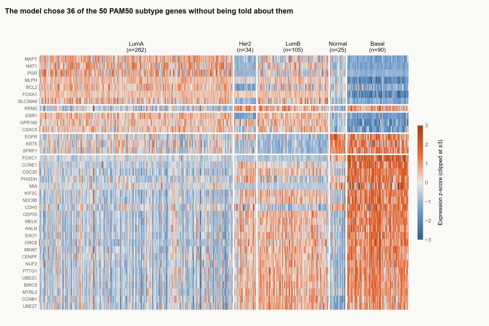
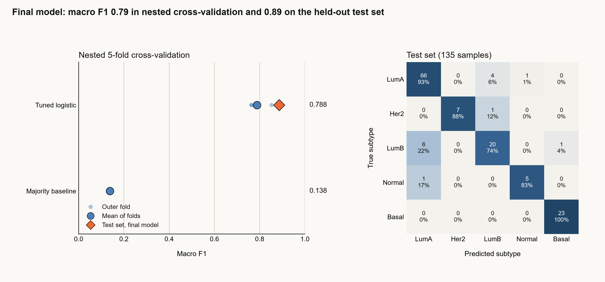
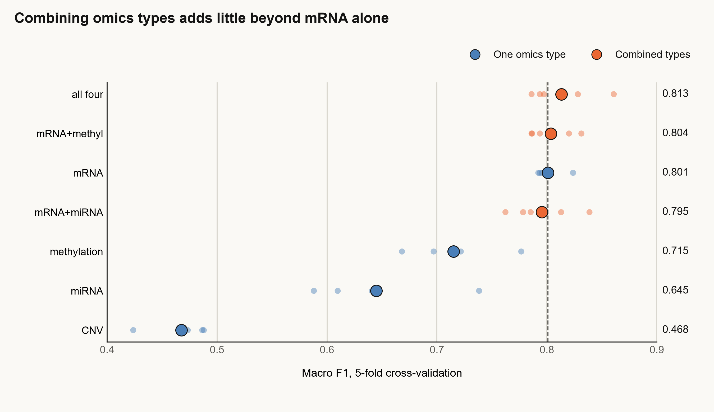
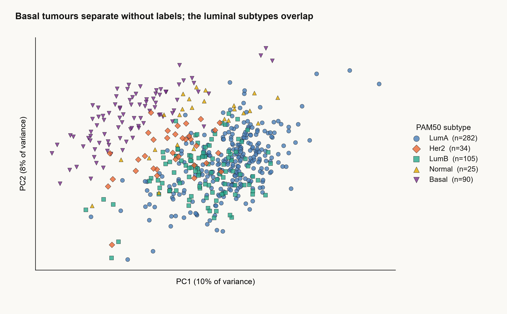
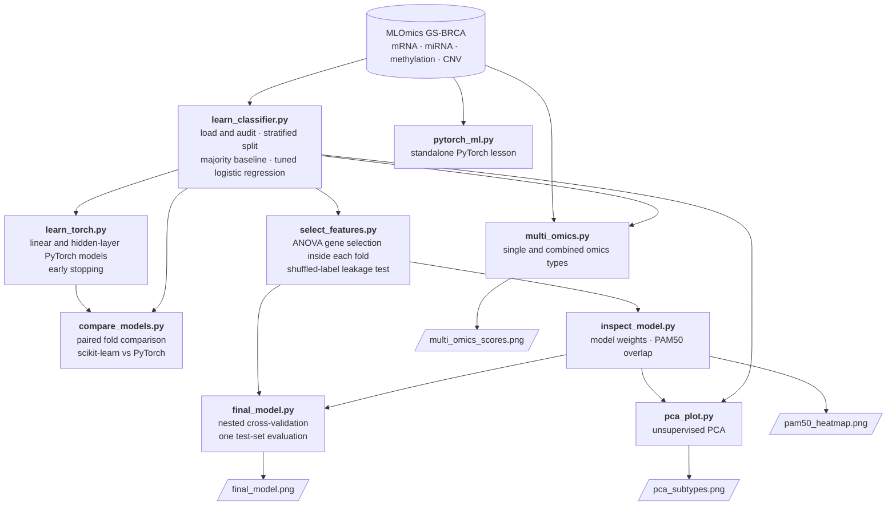

# Cancer omics machine learning

## Code

## Data

The input data come from **MLOmics**, using the `GS-BRCA` classification
dataset: 671 TCGA breast tumours with mRNA, miRNA, DNA methylation and copy
number measurements, each labelled with one of five PAM50 subtypes (LumA, Her2,
LumB, Normal, Basal).

- Dataset: [MLOmics on Hugging Face](https://huggingface.co/datasets/AIBIC/MLOmics) (CC BY 4.0)
- Benchmark code: [Cancer Multi-Omics Benchmark](https://github.com/chenzRG/Cancer-Multi-Omics-Benchmark)
- Paper: Yang, Z. *et al.* MLOmics: Cancer Multi-Omics Database for Machine
  Learning. *Scientific Data* **12** (2025).
  [doi:10.1038/s41597-025-05235-x](https://doi.org/10.1038/s41597-025-05235-x)

The data are not included in this repository; see
[data/README.md](data/README.md) for where to place them.
